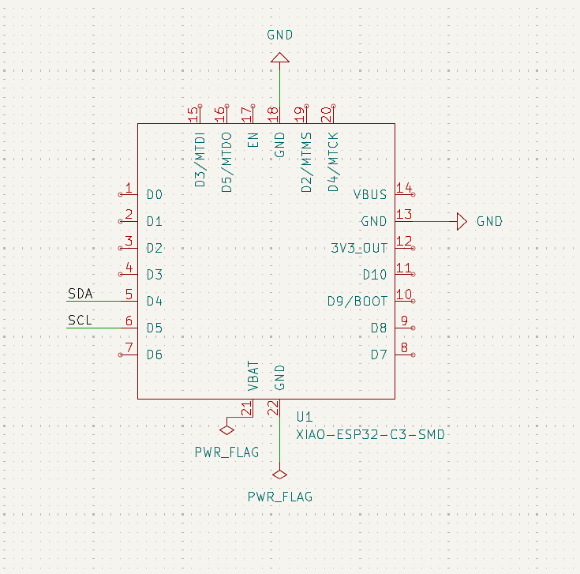
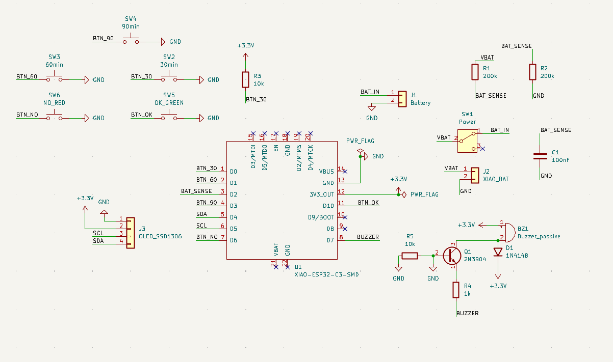
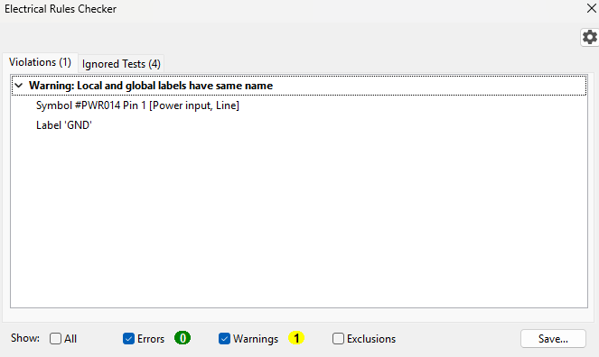
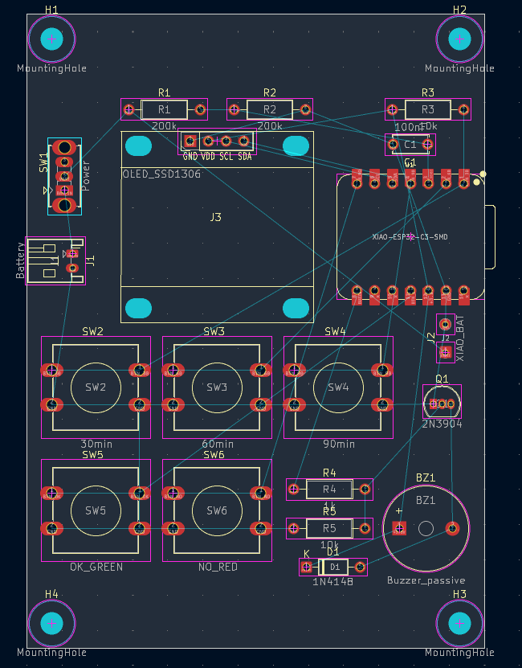
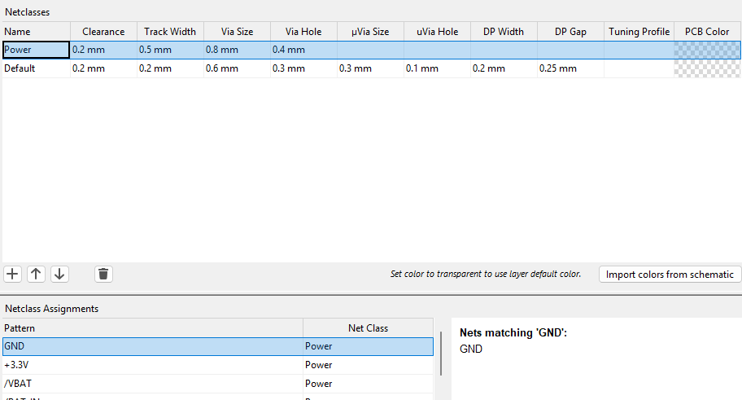
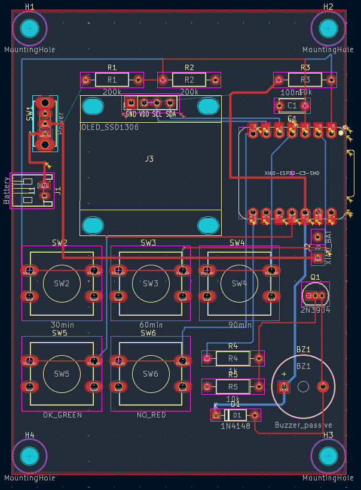
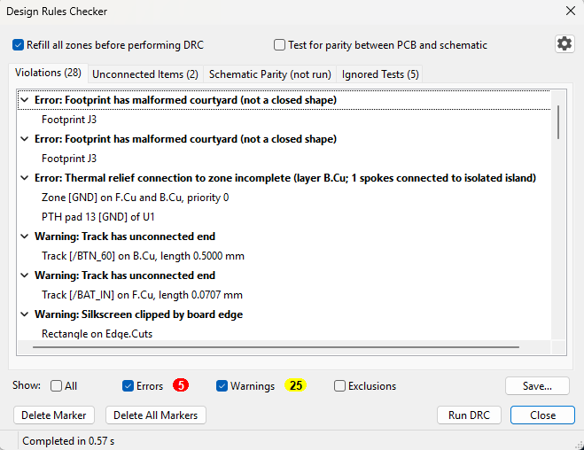

# Kitsujikan — Build Journal

Kitsujikan is a mini rechargeable Pomodoro timer. I'm building it for Hack Club's **Half-Life 10-week hardware challenge**. This was my first time working with hardware.

---

## Week 1: October 5–11, 2024

**Total time spent:** ~7.5 hours.

### October 7: Planning the timer and picking parts

**Time spent:** ~3 hours.

**TL;DR:** I made a plan for a mini Pomodoro timer,
chose the XIAO ESP32-C3 for its built-in charger,
and planned the pins for deep-sleep wake,
the ADC and strapping-pin rules (and caught a boot bug before it existed).

I started from the idea: a mini Pomodoro timer.

- Three buttons to start **30, 60 or 90-minute** session correspondingly.
- The OLED shows the remaining time (format: `HH:MM:SS`).
- After a session, it offers a **5-minute break**.
- After a break, it offers to **repeat** the session.
- The timer should be powered by a **rechargeable battery**.

I used the Half-Life Week 1 example
[Starbie](https://github.com/SharKingStudios/Starbie)
as a reference. These are the parts I chose:

| Block   | Part                                          | Why                                                                 |
|---------|-----------------------------------------------|---------------------------------------------------------------------|
| MCU     | Seeed XIAO ESP32-C3                           | It supports **built-in LiPo charger**                               |
| Display | 0.96" SSD1306 OLED (I2C)                      | Big enough for `HH:MM:SS` plus prompts like "Start break?"          |
| Buttons | 5 × 12 mm tactile switches with colored caps  | 30 / 60 / 90 min, a green one for OK, red for No/Pause              |
| Alarm   | Passive buzzer + 2N3904 transistor            |                                                                     |
| Power   | 3.7 V LiPo + slide switch + 2 resistors       | The XIAO needs a voltage divider lets it read its own battery level |

What I learned about the XIAO ESP32-C3:

- Only **GPIO0–5** can wake the chip from deep sleep
(the low-power mode where most of the chip is turned off).
Pressing one of the 30/60/90 buttons wakes the timer up.
- Analog reading is calibrated on **ADC1 (GPIO0–4)**.
**ADC2 (GPIO5)** isn't calibrated and doesn't work on some chip versions.
- **GPIO2, 8 and 9 are strapping pins.**
The chip reads them at startup to decide how to boot.
For uploading code to work, GPIO2 must read *high*.

My first plan is to put the battery reading on GPIO2, but that turned out to be a mistake.
A full 4.2V battery halved by the divider is 2.1 V;
that's below the ~2.5 V the chip needs to count a pin as "high",
so uploading code is likely to fail.
Therefore, I moved the battery reading to GPIO4.
GPIO2 got the 30-min button plus a 10 kΩ pull-up resistor,
which keeps the pin high until the button is pressed.

| XIAO pin  | GPIO  | Job                           |
|-----------|-------|-------------------------------|
| D0        | 2     | 30-min button + 10 kΩ pull-up |
| D1        | 3     | 60-min button                 |
| D2        | 4     | Battery voltage (divider)     |
| D3        | 5     | 90-min button                 |
| D4 / D5   | 6 / 7 | I2C SDA / SCL to the OLED     |
| D6        | 21    | Red No/Pause button           |
| D7        | 20    | Buzzer transistor             |
| D10       | 10    | Green OK button               |

References:

- [Pull-up resistors](https://learn.sparkfun.com/tutorials/pull-up-resistors):
why a button wired to GND needs a pull-up.
- [Voltage dividers](https://learn.sparkfun.com/tutorials/voltage-dividers):
two equal resistors halve the battery voltage so it fits the ADC's 0–2.5 V range.
With big values (200 kΩ), the divider only wastes about 10 µA.
- [Transistors as switches](https://learn.sparkfun.com/tutorials/transistors)
and [flyback diodes](https://en.wikipedia.org/wiki/Flyback_diode):
a GPIO pin can't power a buzzer directly. The diode absorbs the voltage spike from the buzzer's coil.
- [I2C](https://learn.sparkfun.com/tutorials/i2c):
two shared wires (SDA for data, SCL for the clock) where every device has an address.
- [LiPo batteries](https://learn.adafruit.com/li-ion-and-lipoly-batteries):
use a battery with a protection circuit and **check the plug polarity** (it isn't standardized).

## October 8: Drawing the schematic

**Time spent:** ~1.5 hours.

**TL;DR:** The schematic is done.
I learned the difference between symbols and footprints,
why PWR_FLAG is needed, and local vs. global labels.

I created the KiCad 10 project and loaded the Half-Life care-package libraries.

- The symbol pointed to a footprint library I didn't have installed.
I switched to the care package's `XIAO-ESP32-C6-DIP` footprint.
Every XIAO board has the same outline and pin positions, so it fits the C3.
- That footprint only has pads 1–14, but the symbol has 22 pins.
Pins 15–22 are pads on the *underside* of the XIAO, including **VBAT**.
I marked them no-connect.
The battery reaches the XIAO through two short wires soldered to its underside pads,
which then go through two holes on my board (J2).
That also means the XIAO has to sit on pin headers, so there's room for the wires.
- The Seeed symbol marks every pin as "passive",
so KiCad didn't know that 3V3_OUT provides power.
I added PWR_FLAGs on GND and +3.3V so ERC knows those nets are powered.=

**Bug, found by ERC:** "Local and global labels have same name."

I had used three plain net labels called "GND" instead of GND power symbols.

- **Net labels** are *local*: they only connect within one schematic sheet.
- **Power symbols** are *global*: they connect everywhere in the project.

KiCad doesn't guarantee that a local "GND" label joins the global GND. If it didn't, my battery's minus side wouldn't have reached the board's ground. I replaced the labels with power symbols, and ERC came back clean.

---

## October 8–9: Placing, routing, DRC and Gerbers

**Time spent:** ~3 hours.

**TL;DR:** The board is placed, routed and DRC-clean.
DRC caught two missing connections. The Gerbers, BOM and repo are ready.*

**Net classes.**
Power traces (GND, +3.3V, VBAT, BAT_IN) are 0.5 mm wide, and signals are 0.2 mm.
Wider copper means less voltage lost along the way and less heating.

**Routing.**
That traces can't cross on the same layer was a real challenge.
My plan to tackle that was:

- The long horizontal power run (VBAT) goes on the front.
The signals running down from the XIAO to the buttons go on the back,
so they cross VBAT without touching it.
- Thin signal traces can squeeze between the XIAO's pins,
but power traces are too wide for that.
- GND isn't drawn as traces; it's copper fill on both layers.

**DRC.**
The first design rules check found 5 errors, 25 warnings and 2 unconnected items:

- **2 missing traces:**
VBAT → R1 (the battery reading would always have been 0 V)
and +3.3V → the OLED (the screen would have had no power).
I'm glad DRC caught those!
- **A trapped GND island:**
My back-layer traces fenced in a patch of GND fill under the XIAO.
A **GND stitching via** tied it to the front layer.
- Two leftover trace stubs, deleted with *Cleanup Tracks & Vias*.

Final result: **0 errors, 0 unconnected items**,
with the schematic–PCB parity check on.

| Front                                         | Back                                        |
|-----------------------------------------------|---------------------------------------------|
|  |  |

---
