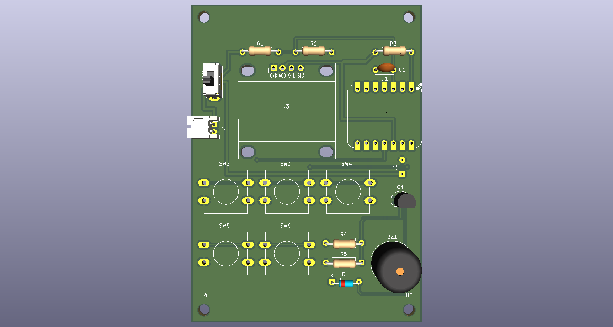
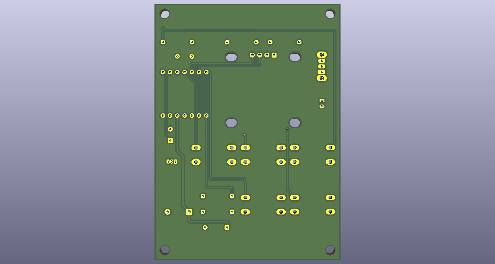

# Kitsujikan

A rechargeable, pocket-sized **Pomodoro timer** with an OLED display and colour-coded buttons, designed for [Hack Club](https://hackclub.com)'s **Half-Life** 10-week hardware challenge.

| Front                                         | Back                                        |
|-----------------------------------------------|---------------------------------------------|
|  |  |

## Features

- **One-press focus sessions:** 30, 60 or 90 minutes, one button each.
- **Automatic breaks:** when a session ends, the buzzer sounds and the timer offers a 5-minute break. Press **green** to accept or **red** to skip. After the break, it offers to repeat the last session length.
- **Clear display:** a 0.96" OLED shows the time left as `HH:MM:SS`. Hours are hidden when zero, and minutes and seconds always show two digits.
- **Pause:** press **red** during a session.
- **Battery powered:** runs from a LiPo battery and charges over USB-C, with an on/off switch and battery-level sensing.
- **Low power:** sleeps when idle, and the 30/60/90 buttons wake it from deep sleep.

## Status

- [x] Schematic
- [x] PCB layout and routing (DRC clean)
- [x] Gerber and drill files
- [x] Bill of materials (BOM)
- [ ] Order the PCB and parts
- [ ] Firmware (Arduino, ESP32-C3)
- [ ] Assembly and testing
- [ ] Enclosure

## Hardware

| Power | 3.7 V LiPo (JST-PH), slide switch, 2 × 200 kΩ battery-sense divider |
| PCB   | 2 layers, 65 × 90 mm, all through-hole parts                        |

### Pin map

| XIAO pin  | GPIO  | Connected to                        | Why this pin                                                                          |
|-----------|-------|-------------------------------------|---------------------------------------------------------------------------------------|
| D0        | 2     | 30-min button (+10 kΩ pull-up)      | Can wake from deep sleep; it's a strapping pin, so the pull-up holds it high at boot  |
| D1        | 3     | 60-min button                       | Can wake from deep sleep                                                              |
| D2 / A2   | 4     | Battery voltage (divider midpoint)  | Calibrated ADC1 channel                                                               |
| D3        | 5     | 90-min button                       | Can wake from deep sleep; its ADC2 channel is unreliable anyway                       |
| D4 / D5   | 6 / 7 | I2C SDA / SCL (OLED)                | Default I2C pins                                                                      |
| D6        | 21    | Red No/Pause button                 | Not a strapping pin                                                                   |
| D7        | 20    | Buzzer transistor                   | Input at boot, so the buzzer stays quiet                                              |
| D10       | 10    | Green OK button                     | General purpose                                                                       |
| D8, D9    | 8, 9  | Unused                              | Strapping pins (D9 is the BOOT button)                                                |

## Directory structure

```plaintext
PCB/                 KiCad 10 project (schematic + board)
PCB/libs/            Symbol, footprint and 3D libraries used by the project
PCB/production/      Gerber and drill files for manufacturing
renders/             3D renders of the board
kitsujikan_BOM.csv   Bill of materials with sources and estimated prices
```

## Bill of materials

The full list with links is in [`kitsujikan_BOM.csv`](kitsujikan_BOM.csv). Summary:

| Qty | Part                                                      | Source          |
|-----|-----------------------------------------------------------|-----------------|
| 1   | Seeed Studio XIAO ESP32-C3                                | Seeed Studio    |
| 1   | 0.96" SSD1306 I2C OLED (pins: GND, VCC, SCL, SDA)         | Amazon          |
| 5   | 12×12 mm tactile switches with coloured caps              | Amazon          |
| 1   | C&K OS102011MS2QN1 slide switch                           | LCSC / DigiKey  |
| 1   | JST-PH 2-pin side-entry socket (S2B-PH-K-S)               | LCSC / DigiKey  |
| 1   | 3.7 V ~500 mAh LiPo with protection circuit, JST-PH plug  | Amazon          |
| 1   | Passive buzzer, 12 mm                                     | Amazon          |
| 1   | 2N3904 transistor, 1N4148 diode                           | Amazon          |
| 5   | Resistors: 2 × 200 kΩ, 2 × 10 kΩ, 1 × 1 kΩ                | Amazon          |
| 1   | 100 nF ceramic capacitor                                  | Amazon          |
| —   | Female pin headers (1×7 ×2, 1×4 ×1), thin wire            | Amazon          |
| 5   | PCBs                                                      | JLCPCB          |

Prices in the CSV are rough estimates. Many Amazon items come in multi-packs, so the first build costs more than the parts on one board.

## Ordering the PCB

1. Zip the contents of `PCB/production/`.
2. Upload the zip at [jlcpcb.com](https://jlcpcb.com).
3. The defaults work: 2 layers, 1.6 mm, HASL. Pick any solder mask colour.

## Notes on assembly

- **Mount the XIAO on female headers, not flat.** The battery connects to pads on its *underside* (BAT+ / BAT−). Solder two short wires to those pads, thread them through the **J2** holes, and solder them on the back.
- **Check the OLED pin order** before soldering its socket. This board expects **GND, VCC, SCL, SDA**.
- **Check the LiPo plug polarity** before plugging it in. **J1 pin 1 is +.** Battery plug colours aren't standardised.
- **Charging only works with the power switch ON**, because the switch disconnects the battery.
- **Keep the battery away from the sharp solder joints on the back.** Use foam tape, or standoffs and a back plate.
- Solder the low parts first (resistors, diode), then the transistor, buzzer, switches and headers.

## Firmware

Coming soon. It will be an Arduino sketch for the ESP32-C3, using Adafruit SSD1306 / GFX for the display.

## Acknowledgements

- [Hack Club](https://hackclub.com) and the Half-Life challenge
- [Starbie](https://github.com/SharKingStudios/Starbie), the Half-Life Week 1 example project, and its care-package libraries
- Seeed Studio for the XIAO KiCad symbol library

## License

This project is released under the [MIT License](LICENSE). Third-party libraries in `PCB/libs/` remain under their original authors' licenses.
